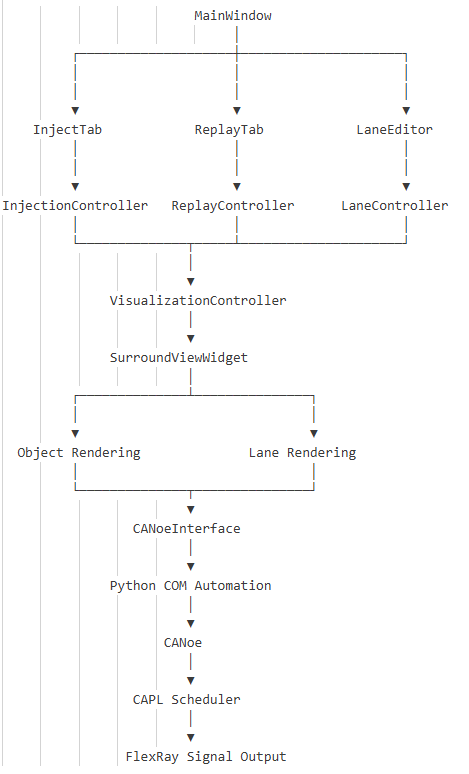
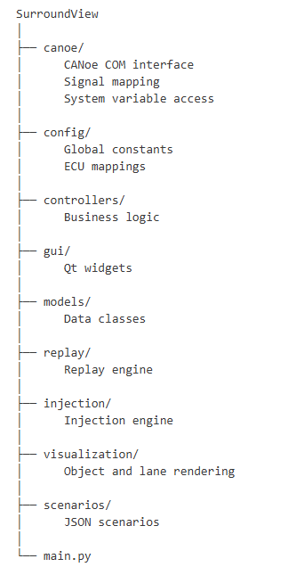
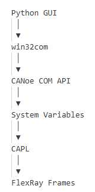

# Architecture Diagram

                         +----------------------------------+
                         |          SurroundView GUI        |
                         |----------------------------------|
                         | Inject Tab                       |
                         | Replay Tab                       |
                         | Lane Geometry Tab                |
                         +----------------+-----------------+
                                          |
                                          |
                           User Actions   |
                                          v
                 +--------------------------------------+
                 |            Controllers               |
                 |--------------------------------------|
                 | Injection Controller                 |
                 | Replay Controller                    |
                 | Lane Controller                      |
                 | Visualization Controller             |
                 +----------------+---------------------+
                                  |
               +------------------+------------------+
               |                                     |
               v                                     v
      +--------------------+              +----------------------+
      |   CANoe Interface  |              | Visualization Widget |
      |--------------------|              |----------------------|
      | write_scenario()   |              | draw_objects()       |
      | write_lane()       |              | draw_lanes()         |
      | COM Interface      |              | PyQtGraph            |
      +---------+----------+              +-----------+----------+
                |                                     ^
                |                                     |
                v                                     |
         +--------------+                     +------------------+
         | CANoe System |                     | Lane Geometry    |
         | Variables    |                     | Polynomial Model |
         +------+-------+                     +------------------+
                |
                |
                v
          +-------------+
          | CAPL Script |
          +------+------+
                 |
                 |
                 v
          FlexRay Signals

# Class diagram

# Repository structure

# CANoe Communication

